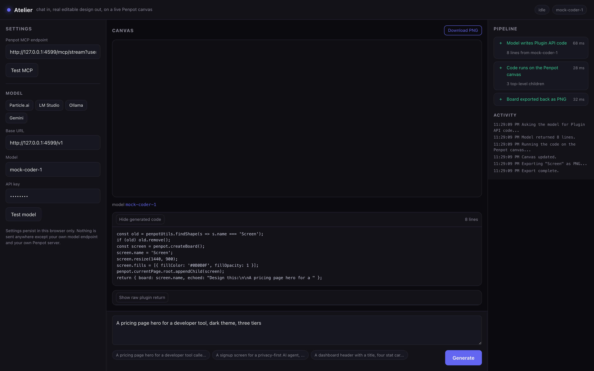
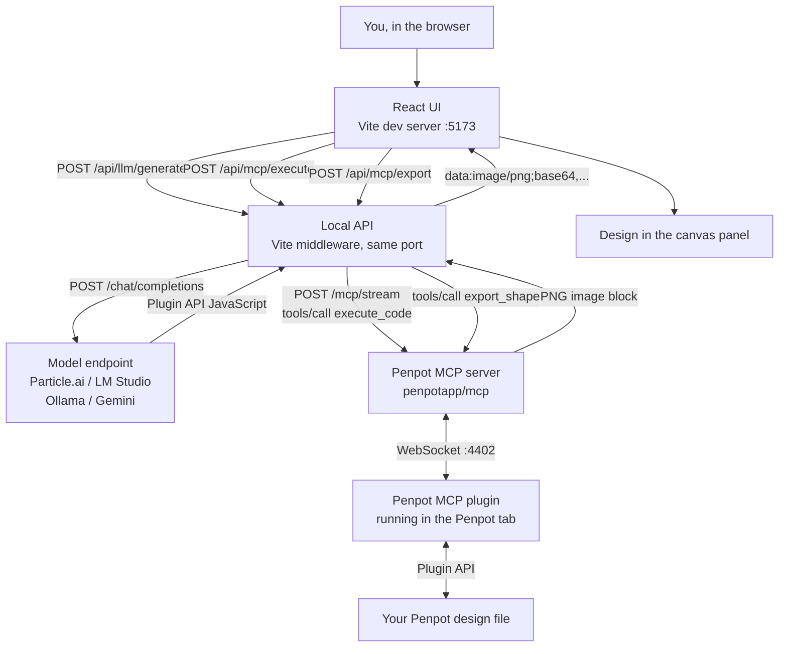

# Atelier

**Chat in, and a real, editable design appears on a live Penpot canvas.**

Atelier is not an image generator. You describe a screen, an LLM writes real Penpot
Plugin API JavaScript, that code runs against a real Penpot file, and the resulting
board is exported back as a PNG. What you end up with is a design you can open in
Penpot and keep editing, not a picture of one.




https://github.com/user-attachments/assets/bd343a20-8cdf-440d-a88b-99464885ab41


```
npm install && npm run dev
```

---

## Table of contents

- [Why this exists](#why-this-exists)
- [What happens when you press Generate](#what-happens-when-you-press-generate)
- [Architecture](#architecture)
- [Tech stack](#tech-stack)
- [Requirements](#requirements)
- [The two Penpot steps people get wrong](#the-two-penpot-steps-people-get-wrong)
- [Quickstart](#quickstart)
- [Configuration](#configuration)
- [Code walkthrough](#code-walkthrough)
- [The seven traps](#the-seven-traps)
- [Verification](#verification)
- [Project structure](#project-structure)
- [Forking and contributing](#forking-and-contributing)
- [Feature ideas worth building](#feature-ideas-worth-building)
- [Non-goals](#non-goals)
- [Troubleshooting](#troubleshooting)
- [Known limits](#known-limits)
- [License](#license)

---

## Why this exists

Every "AI generates UI" tool today ends the same way: you get a picture, or you get a
pile of React you did not ask for. Neither is a design. A picture cannot be edited by
a designer, and generated React is a diff nobody reviewed.

Penpot is the interesting middle. It is open source, it stores designs as real web
structures, and since 2.18 it ships an **MCP server** so an agent can read and write
the canvas directly. That means an agent can produce an actual design artifact, in a
tool a human can keep working in.

Atelier is the smallest useful thing you can build on that: one prompt box, three
steps, and a real board at the end.

The design goal was **visible process over magic**. Every step is timed and reported,
the generated code is always inspectable, and the raw MCP payload is one click away.
When something breaks you can see exactly which of the three steps broke and why.

## What happens when you press Generate

```
 [1] generate   model writes Penpot Plugin API JavaScript
 [2] execute    that code runs against your Penpot file
 [3] export     the resulting board comes back as a PNG
```

Three steps, each independently retryable, each with a real duration.

## Architecture



The request flow, in order:

```mermaid
sequenceDiagram
    participant U as Browser
    participant A as Local API
    participant L as Model
    participant M as Penpot MCP
    participant P as Penpot plugin

    U->>A: POST /api/llm/generate {request}
    A->>L: chat/completions (system prompt + request)
    L-->>A: Penpot Plugin API JavaScript
    A-->>U: {code}
    Note over U: code is shown, never hidden

    U->>A: POST /api/mcp/execute {code}
    A->>M: initialize  ->  mcp-session-id
    A->>M: notifications/initialized
    A->>M: tools/call execute_code
    M->>P: task over WebSocket
    P->>M: result
    M-->>A: {"result": ..., "log": ""} as a JSON string
    A-->>U: {result, isError}

    U->>A: POST /api/mcp/export {shapeName}
    A->>M: tools/call execute_code (resolve board id by name)
    A->>M: tools/call export_shape
    M-->>A: image content block (base64)
    A-->>U: data:image/png;base64,...
```

### Why a local API server instead of calling from the browser

`npm run dev` serves the React app **and** a small JSON API on the same port. This is
deliberate, for two reasons:

1. **CORS.** The Penpot MCP endpoint and most model endpoints do not send CORS
   headers, so a browser `fetch` straight to them is blocked. Server-side, no such rule.
2. **Session handling.** The MCP `initialize` reply carries an `mcp-session-id`
   response header that has to be echoed on every subsequent call. Threading that
   through the browser is awkward; server-side it is three lines.

The API is mounted as a Vite plugin, so it works identically in `vite dev` and
`vite preview`. No second process, no proxy config, no `concurrently`.

```ts
// vite.config.ts
function atelierApi(): Plugin {
  return {
    name: 'atelier-api',
    configureServer(server) { server.middlewares.use(apiMiddleware); },
    configurePreviewServer(server) { server.middlewares.use(apiMiddleware); },
  };
}
```

Everything stays on your machine. Your API key travels browser -> localhost -> your
model endpoint, and nowhere else.

## Tech stack

| Layer | Choice | Why |
| --- | --- | --- |
| UI | React 18 + TypeScript | Predictable state for a three-step pipeline |
| Build / dev server | Vite 7 | Fast HMR, and its plugin API gives us a real server without a second process |
| Local API | Node 20+ built-ins only | `node:http` + global `fetch`, zero runtime dependencies |
| MCP transport | Hand-rolled Streamable HTTP client | ~150 lines, no SDK to keep in sync |
| Model | Any OpenAI-compatible endpoint | Particle.ai by default, presets for LM Studio, Ollama, Gemini |
| Design target | Penpot 2.18+ via its MCP server | Open source, real canvas, agent-readable file format |
| Verification | Node test harness + Playwright | Proves the pipeline with no Penpot instance required |
| Styling | Hand-written CSS, custom properties | No framework, no build step, easy to re-theme |

**Runtime dependencies: `react` and `react-dom`. That is the whole list.**

## Requirements

- **Node.js 20.19+ or 22.12+** (Vite 7's floor). Node 24 and 26 are fine.
- **A Penpot instance with MCP enabled**, either:
  - **Self-hosted** (recommended, fully free). The official docker-compose stack
    already includes a `penpot-mcp` container, and Penpot's frontend proxies the MCP
    endpoint at `http://localhost:9001/mcp/stream`. Set `enable-mcp` in
    `PENPOT_FLAGS` if it is not already there.
  - **Penpot SaaS**. Enable MCP under *Your account -> Integrations -> MCP Server* and
    use the URL Penpot gives you.
- **A model endpoint.** Particle.ai by default. LM Studio, Ollama, and Gemini all work
  through their OpenAI-compatible endpoints.

## The two Penpot steps people get wrong

Both of these cost real debugging time, so they are stated up front.

### 1. The endpoint needs a `userToken`

The official Penpot MCP container always runs `node index.js --multi-user`, so every
session must carry a per-user token. Without it, static calls still answer and file
calls fail with:

```
Error: No userToken found in session context. Multi-user mode requires authentication.
```

Get the key in Penpot under **Your account -> Integrations -> MCP Server**. Penpot
shows a ready-made URL with the token already appended. Atelier warns you in the UI if
your URL is missing one.

### 2. The plugin must be connected

In Penpot, open a design file and use **File -> MCP Server -> Connect**. Leave that tab
open and active. Until you do:

```
Error: No Penpot instance connected for user token.
```

**Do not use `high_level_overview` as a health check.** It returns static text, so it
answers happily even with no plugin connected. Atelier's own verification suite asserts
this distinction, because it fooled us during development.

## Quickstart

```bash
git clone https://github.com/harishkotra/atelier
cd atelier
npm install
npm run dev
```

Open the URL it prints (usually `http://localhost:5173`), then in **Settings**:

1. Paste your **Penpot MCP endpoint**, including `?userToken=...`
2. Press **Test MCP**. You should see `penpot` and its 4 tools
3. Pick a model preset, add your key if it needs one, press **Test model**
4. Describe a screen and press **Generate** (or `Cmd`/`Ctrl` + `Enter`)

Production build, still one port:

```bash
npm run build
npm run preview
```

## Configuration

Settings persist in the browser's localStorage. `.env` only supplies first-run
defaults, and is entirely optional.

| Variable | Default |
| --- | --- |
| `VITE_DEFAULT_MCP_URL` | `http://localhost:9001/mcp/stream` |
| `VITE_DEFAULT_LLM_BASE_URL` | `https://api.particle.ai/v1` |
| `VITE_DEFAULT_LLM_MODEL` | `deepseek-v4.1-flash` |

Built-in model presets: **Particle.ai**, **LM Studio**, **Ollama**, **Gemini**.

Running Atelier on the same machine as Penpot is the recommended setup and `localhost`
is then correct. If they are on different machines, replace `localhost` with the Penpot
host's LAN address in the MCP URL.

## Code walkthrough

### 1. The prompt does the heavy lifting

The system prompt in `server/prompt.ts` is the most important file in the project. It
teaches the model the Penpot Plugin API *and* the traps, so you do not rediscover them
per request.

```ts
export const SCREEN_NAME = 'Screen';

export const SYSTEM_PROMPT = `You write JavaScript that runs inside the Penpot Plugin API...

# THE TEXT TRAP - read this twice
A freshly created Text shape is 1px wide. If you leave it that way, the browser
renders it ONE CHARACTER PER LINE and the design is destroyed.

    const t = penpot.createText('Headline');
    t.resize(1200, 20);          // explicit width
    t.growType = 'auto-height';  // height follows the wrapped content
    t.align = 'center';
    t.fontSize = 72;
...`;
```

`SCREEN_NAME` is a **contract** between the prompt and the export step: the model is
told to name the top-level board `Screen`, and `server/middleware.ts` exports the board
with that name. It is exported from one place so the two can never drift.

### 2. A dependency-free MCP client

`server/mcpClient.ts` speaks MCP Streamable HTTP in about 150 lines. The whole
transport is one POST shape plus a session header:

```ts
const res = await fetch(url, {
  method: 'POST',
  headers: {
    'Content-Type': 'application/json',
    Accept: 'application/json, text/event-stream',
    ...(sessionId ? { 'mcp-session-id': sessionId } : {}),
  },
  body: JSON.stringify(body),
  signal: controller.signal,
});
```

Two details that matter:

```ts
// Penpot replies as SSE, not bare JSON.
function parsePayload(text: string): unknown[] {
  const messages: unknown[] = [];
  let sawSse = false;
  for (const rawLine of text.split(/\r?\n/)) {
    const line = rawLine.trimStart();
    if (!line.startsWith('data:')) continue;
    sawSse = true;
    const payload = line.slice(5).trim();
    if (!payload || payload === '[DONE]') continue;
    try { messages.push(JSON.parse(payload)); } catch { /* partial frame */ }
  }
  if (!sawSse && text.trim()) {
    try { messages.push(JSON.parse(text)); } catch { /* not JSON */ }
  }
  return messages;
}
```

```ts
// execute_code wraps its payload as a JSON *string* inside a text block.
export function unwrapExecuteResult(text: string): unknown {
  try {
    const parsed = JSON.parse(text) as Record<string, unknown>;
    if (parsed && typeof parsed === 'object' && 'result' in parsed) return parsed.result;
    return parsed;
  } catch {
    return text;
  }
}
```

Errors are surfaced **verbatim**, because Penpot's messages are already the most
actionable thing available. That is why a missing token reads exactly like Penpot said
it, not like a generic "request failed".

### 3. Export by id, never by page

Exporting the page fails, because the page root frame is zero-sized and Penpot's
exporter waits for an element that never becomes visible. So the export endpoint
resolves the board by name first:

```ts
// server/middleware.ts, POST /api/mcp/export
const lookup = await callTool(mcpUrl, 'execute_code', {
  code: `const s = penpotUtils.findShape(x => x.name === ${JSON.stringify(shapeName)});`
      + `return s ? { id: s.id, name: s.name, type: s.type, width: s.width, height: s.height } : null;`,
}, session.sessionId);

const found = unwrapExecuteResult(lookup.text) as { id?: string } | null;
if (!found?.id) {
  return { ok: false, text: `No shape named "${shapeName}" on the current page. Run a generation first.` };
}

const exported = await callTool(mcpUrl, 'export_shape',
  { shapeId: found.id, format: 'png', mode: 'shape' }, session.sessionId, 60_000);
```

### 4. The UI shows its work

`src/App.tsx` runs the three steps and patches each one's status as it goes, so a
failure points at the exact step that broke:

```ts
patchStep('generate', { status: 'running' });
const gen = await generateCode(config, prompt);
patchStep('generate', { status: 'ok', ms: Math.round(performance.now() - t0),
                        detail: `${code.split('\n').length} lines from ${gen.model}` });

patchStep('execute', { status: 'running' });
const exec = await executeCode(config, code);
if (exec.isError) throw new Error(exec.text || 'execute_code reported an error.');
```

If a step throws, the code is still kept so you can read it:

```ts
} catch (err) {
  setError(message);
  failRunningStep(message.slice(0, 120));
  if (code) setOutcome({ code, summary, image: null, execLog, model, usage });
}
```

## The seven traps

Every one of these was found by running against a real Penpot 2.18 instance and
inspecting the exported pixels. They are encoded in `server/prompt.ts` and
`server/mcpClient.ts` so you do not have to rediscover them.

1. **Text renders one character per line.** A freshly created Text shape is 1px wide.
   Leave it that way and a headline becomes a vertical stack of letters. The returned
   data looks fine; the pixels are ruined. Fix: `resize()` to an explicit width, then
   `growType = 'auto-height'`. Do not rely on `auto-width` for a shape you just created,
   because it will not reliably reflow from 1px.
2. **Exporting the page fails.** The page root frame is zero-sized. Resolve the board by
   name and export it by id.
3. **Hex colours must be uppercase.** `'#6366F1'`, not `'#6366f1'`.
4. **`fills` / `strokes` / `shadows` are replaced, never mutated.** Assign a whole new
   array.
5. **Add flex layout before appending children**, or the existing visual order gets
   scrambled. If the container already has children, use
   `penpotUtils.addFlexLayout(container, dir)`.
6. **`width` / `height` are read-only.** Use `shape.resize(w, h)`.
7. **Re-running must be idempotent.** The generated code removes any existing board
   named `Screen` first, so generations replace rather than pile up.

Plus one transport trap:

8. **`execute_code` returns its payload as a JSON string inside a text block**, not as
   structured data. See `unwrapExecuteResult()`.

## Verification

Two harnesses, both runnable with **no Penpot instance required**.

```bash
npm run verify      # 30 assertions against a mock Penpot MCP server
npm run typecheck   # tsc, zero errors
npm run build       # production build
```

### What `npm run verify` actually does

It starts `test/mock-mcp-server.mjs`, which deliberately reproduces Penpot's real
behaviour: SSE framing, the `mcp-session-id` header, the `userToken` requirement, the
"no plugin connected" error, `execute_code` returning a JSON string, and `export_shape`
returning a base64 image block. It then drives the **real** Vite middleware and the
**real** MCP client and asserts 30 behaviours across ten groups:

| # | Group | What is asserted |
| --- | --- | --- |
| 1 | health | reports ok, screen-name contract is `Screen` |
| 2 | MCP connect | initialize + initialized + tools/list, `serverInfo.name`, 4 tools, exact tool names |
| 3 | model codegen | markdown fences stripped, leading prose stripped, starts with real JS, usage passed through |
| 4 | execute | `execute_code` JSON string unwrapped, children parsed |
| 5 | missing token | failure surfaced, and the text names the `userToken` |
| 6 | no plugin | failure surfaced, and the text names the plugin |
| 7 | export | data URL produced, **decoded bytes are a real PNG**, shape resolved by name |
| 8 | model list | models returned |
| 9 | bad endpoint | unreachable MCP gives an actionable error |
| 10 | unknown route | 404 with a JSON body |

The PNG assertion is the interesting one. It does not trust the string prefix; it
decodes the base64 and checks the actual magic bytes:

```js
const bytes = Buffer.from(b64, 'base64');
const isPng = bytes.length > 8 && bytes[0] === 0x89 && bytes[1] === 0x50
           && bytes[2] === 0x4e && bytes[3] === 0x47;
check('decoded bytes are a real PNG', isPng, `first bytes: ${bytes.subarray(0, 4).toString('hex')}`);
```

### Browser flow

```bash
node test/mock-mcp-server.mjs 4599   # terminal 1
npm run dev                          # terminal 2
python3 test/ui-e2e.py               # terminal 3  (needs playwright)
```

That drives the real React app in headless Chromium: fills the settings through the real
inputs, types a prompt, clicks Generate, waits for the pipeline, then asserts the canvas
holds a PNG data URL, all three steps report ok, and the browser console is clean.

Verified results on macOS (Node 23.3.0, and independently on Node 22.18):

| Check | Result |
| --- | --- |
| `npm run verify` | 30 passed, 0 failed on both Node versions |
| `npm run typecheck` | 0 errors |
| `npm run build` | 154.7 kB JS, 50.2 kB gzipped |
| `npm audit` | 0 vulnerabilities |
| Browser E2E | passed, console clean |
| Live Penpot 2.18 | handshake, 4 tools, and a real `execute_code` returning pages and shape counts |

The last row is worth stating plainly: the MCP client was run against a real
self-hosted Penpot 2.18 with the plugin connected, and it returned live page data. The
mock exists so the suite runs without Penpot, not because the real path is untested.

## Project structure

```
atelier/
├── server/                     # runs inside the Vite dev/preview server
│   ├── mcpClient.ts            # MCP Streamable HTTP client, zero dependencies
│   ├── llm.ts                  # OpenAI-compatible client + code extraction
│   ├── prompt.ts               # the codegen prompt, including the traps
│   └── middleware.ts           # /api routes
├── src/
│   ├── App.tsx                 # pipeline orchestration
│   ├── main.tsx
│   ├── styles.css
│   ├── types.ts
│   ├── components/
│   │   ├── SettingsPanel.tsx   # endpoints, presets, Test MCP / Test model
│   │   ├── CanvasPanel.tsx     # exported design, code, raw payload
│   │   └── StepsPanel.tsx      # per-step status + activity log
│   └── lib/
│       ├── api.ts              # typed wrappers over the local API
│       └── config.ts           # localStorage config + presets + URL validation
├── test/
│   ├── mock-mcp-server.mjs     # mock Penpot MCP + mock model endpoint
│   ├── verify.mjs              # 30-assertion API verification
│   └── ui-e2e.py               # headless browser test
├── content/                    # blog and social drafts for this build
├── results/                    # screenshots referenced by this README
├── vite.config.ts              # mounts the API plugin for dev and preview
├── .env.example
├── LICENSE
└── README.md
```

## Forking and contributing

Fork it and it runs. There is no service to provision and no account to create beyond
Penpot and a model endpoint.

### Development setup

```bash
git clone https://github.com/harishkotra/penpot-design-ui-with-ai
cd atelier
npm install
npm run verify        # green before you change anything
npm run dev
```

### Ground rules

- **No new runtime dependencies without a strong reason.** `server/` currently uses
  only Node built-ins. Keep it that way if you can.
- **Every behaviour you add needs an assertion in `test/verify.mjs`.** The suite exists
  so that a change to the MCP client or the prompt cannot silently break the pipeline.
  Add a mock behaviour in `test/mock-mcp-server.mjs` if you need one.
- **Keep errors verbatim.** If Penpot says something specific, pass it through. Do not
  wrap it in a generic message.
- **Do not hide the generated code.** It is the product's honesty mechanism.
- **TypeScript strict is on**, including `noUnusedLocals` and `noUnusedParameters`.

### Pull request checklist

- [ ] `npm run verify` passes, and you added assertions for new behaviour
- [ ] `npm run typecheck` is clean
- [ ] `npm run build` succeeds
- [ ] `python3 test/ui-e2e.py` still passes if you touched the UI
- [ ] README updated if you changed configuration or behaviour
- [ ] New trap discovered? Add it to [The seven traps](#the-seven-traps) and to
      `server/prompt.ts` so the model is told about it too

### If you hit a new Penpot trap

The most valuable contribution is a new entry in that list. Reproduce it, describe the
symptom, the cause, and the fix, then add a line to the system prompt so the model
avoids it automatically. That is the mechanism that makes this project get better.

## Feature ideas worth building

Roughly ordered by value against effort.

**Close to the current shape**

1. **Variant grid.** Generate 4 boards side by side from one prompt, export all 4 as a
   contact sheet, and let the user keep one. Turns a single shot into an explore step.
2. **Iterate on the existing board.** Send the current board's structure back as context
   so "make the headline bigger" edits rather than regenerates. The
   `canvasSummary` hook already exists in `buildUserPrompt()`.
3. **Design tokens.** Create a real Penpot token set, bind the generated shapes to it,
   and export the set as CSS variables and a Tailwind config. This is the natural bridge
   from design to shipped code.
4. **Screenshot to design.** Paste an image of any UI, and have the model reproduce it
   as an editable Penpot board rather than a picture.
5. **Undo.** Keep the previous board id and add a Revert button, since generation
   currently replaces in place.

**Bigger, still local**

6. **Real streaming.** Stream the model's tokens and the MCP step transitions over SSE so
   the canvas fills in progressively instead of after a pause.
7. **Multi-screen flows.** Generate a linked set of boards (onboarding, empty state,
   error state) with Penpot flows connecting them.
8. **Accessibility pass.** Use the Plugin API to compute contrast ratios on every text
   layer against its background and fail the run below WCAG AA, then ask the model to fix
   the palette. This is a genuinely useful gate that no design tool does automatically.
9. **Component extraction.** After generating a few screens, ask the agent to find
   repeated structures and promote them into real Penpot components.
10. **Local model mode.** A one-command profile for LM Studio and Ollama with a model
    recommendation table, since the Plugin API codegen quality varies a lot by model.

**Platform**

11. **A skill/tool registry.** Package the system prompt and the trap list as a
    versioned artifact others can import, so improvements are shared rather than copied.
12. **Design review mode.** Point it at an existing Penpot file instead of a blank one
    and have it audit naming, spacing, off-system colours, and orphaned layers, then
    apply the fixes it proposes.

## Non-goals

- No auth, no accounts, no database, no cloud service. It is a local tool.
- No deployment story. `npm run preview` is the production path.
- It does not edit arbitrary existing designs in place. It creates or replaces the board
  named `Screen`.
- No token-by-token streaming. Each step completes, then reports.
- No image generation. The output is vector structure on a canvas, not pixels from a
  diffusion model.

## Troubleshooting

### `localhost:5173` shows a 404, or shows a different app

Symptom: `npm run dev` prints a URL, but the browser returns a 404 with an empty
body, or renders an app you do not recognise.

Cause: on macOS `/etc/hosts` maps `localhost` to **both** `127.0.0.1` and `::1`, and the
resolver tries `::1` first. If another dev server is holding `[::1]:5173`, then
`localhost:5173` reaches **that** server while `127.0.0.1:5173` reaches Atelier. The OS
permits both binds, because one is IPv6 loopback and the other is the IPv4 wildcard, so
nothing warns you. A stale Vite process from a deleted project is the usual squatter.

Diagnose:

```bash
# Who is on 5173, and are there two of them?
lsof -nP -iTCP:5173 -sTCP:LISTEN

# The split, made visible
curl -sS -o /dev/null -w "ipv4 %{http_code}\n" http://127.0.0.1:5173/
curl -sS -o /dev/null -w "ipv6 %{http_code}\n" http://[::1]:5173/
```

Fix it immediately by using the IPv4 address: **http://127.0.0.1:5173**

Fix it properly by removing the squatter. Confirm it is nothing you care about first. A
server whose project directory no longer exists is a zombie, and its response body is
usually empty:

```bash
lsof -nP -iTCP:5173 -sTCP:LISTEN   # note the pid
ps -p <pid> -o pid,lstart,command  # how long has it been running?
kill <pid>
```

### Port 5173 is already in use

Vite moves to 5174 on its own. Read the URL it prints instead of assuming 5173.

### "No userToken found in session context"

Your MCP URL is missing `?userToken=<key>`. See
[the two Penpot steps](#the-two-penpot-steps-people-get-wrong).

### "No Penpot instance connected for user token"

The token is right, but the plugin is not connected. In Penpot, open a design file and
use **File -> MCP Server -> Connect**, then keep that tab awake.

### A step times out

Almost always the Penpot tab being suspended. Pin it, and in Chrome add your Penpot site
under *Settings -> Performance -> Always keep these sites active*.

## Known limits

- A mid-tier model handles one scoped screen well, but gets shaky on large
  multi-section layouts. Keep prompts specific and iterate.
- Penpot's MCP surface is essentially one tool, `execute_code`, so the model writes raw
  Plugin API JavaScript. Stronger models do noticeably better here.
- If the Penpot tab sleeps or is backgrounded aggressively, the MCP server rejects tasks
  until it wakes. Pin the tab; in Chrome add your Penpot site under
  *Settings -> Performance -> Always keep these sites active*.
- The MCP endpoint has no authentication beyond the token. Do not expose it beyond your
  own machine or LAN.

## License

MIT. See [LICENSE](LICENSE).
